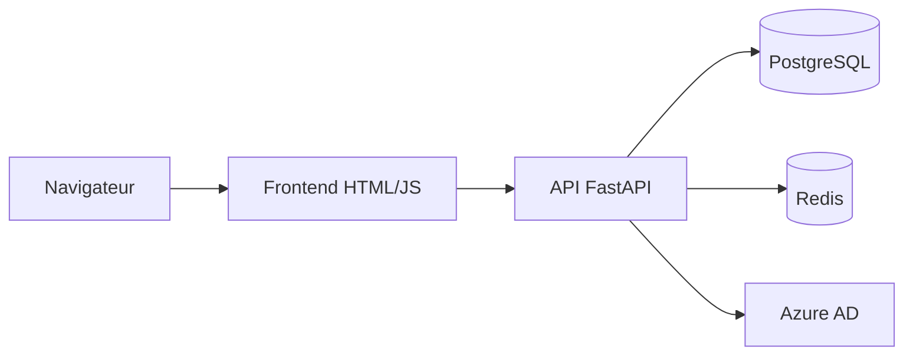

# Documentation consolidée — DIGITRANS-CM CRM

Ce document rassemble les informations techniques clés et sert de point d'entrée vers les guides existants.

## 1. Présentation

Module CRM du projet DIGITRANS-CM pour AGROCAM S.A. : gestion des clients, des contacts, des interactions et tableau de bord.

## 2. Architecture



| Couche | Technologie | Dossier ou fichier |
|---|---|---|
| Frontend | HTML, CSS, JavaScript, Nginx | `frontend/` |
| Backend | Python 3.11, FastAPI, SQLAlchemy | `backend/` |
| Données | PostgreSQL 15, Redis 7 | `docker-compose.yml` |
| Infrastructure | Terraform : VPC, ECS, ECR, RDS, S3, SNS | `infrastructure/aws/` |
| Kubernetes | Manifestes de namespace et de déploiement | `infrastructure/kubernetes/` |

## 3. Lancement local

```bash
docker compose up --build
```

| Service | Adresse |
|---|---|
| Frontend | `http://localhost` |
| API | `http://localhost:8000` |
| État de l'API | `http://localhost:8000/health` |

Les valeurs de `docker-compose.yml` sont réservées au développement local. Ne les réutilisez jamais dans un autre environnement.

## 4. API

Les routes métier sont préfixées par `/api`.

| Méthode | Route | Domaine |
|---|---|---|
| GET, POST | `/clients` | Clients |
| GET, PUT, DELETE | `/clients/{client_id}` | Clients |
| GET | `/clients/{client_id}/contacts` | Contacts |
| POST | `/contacts` | Contacts |
| GET, DELETE | `/contacts/{contact_id}` | Contacts |
| GET, POST | `/interactions` | Interactions |
| GET | `/interactions/{interaction_id}` | Interactions |
| GET | `/stats/dashboard` | Statistiques |

Le détail figure dans [api-documentation.md](api-documentation.md).

## 5. Modèle de données

Les modèles SQLAlchemy `Client`, `Contact` et `Interaction` sont définis dans `backend/app/models.py`.

## 6. Configuration

Variables utilisées par le backend dans `docker-compose.yml` : `DATABASE_URL`, `REDIS_URL`, `AZURE_CLIENT_ID`, `AZURE_CLIENT_SECRET`, `AZURE_TENANT_ID`, `SECRET_KEY` et `ENVIRONMENT`.

## 7. Pipeline CI/CD

Le workflow `.github/workflows/ci-cd.yml` se déclenche sur `main` et `develop`, ainsi que sur les pull requests vers `main`.

| Job | Rôle |
|---|---|
| `test-backend` | Tests de l'API avec PostgreSQL |
| `lint-and-security` | Qualité du code et sécurité |
| `terraform` | Infrastructure AWS |
| `build-docker` | Construction de l'image |
| `deploy-ecs` | Déploiement sur ECS |
| `notify` | Notification du résultat |

## 8. Guides existants

| Sujet | Document |
|---|---|
| Architecture | [ARCHITECTURE.md](../ARCHITECTURE.md), [ARCHITECTURE-HYBRIDE-GUIDE.md](ARCHITECTURE-HYBRIDE-GUIDE.md) |
| Démarrage | [QUICKSTART.md](../QUICKSTART.md), [DEMARRAGE-RAPIDE.md](../DEMARRAGE-RAPIDE.md) |
| Déploiement | [DEPLOYMENT.md](../DEPLOYMENT.md), [DEPLOIEMENT-COMPLET-AWS.md](DEPLOIEMENT-COMPLET-AWS.md) |
| CI/CD | [QUICK-START-CICD.md](QUICK-START-CICD.md), [TROUBLESHOOTING-CICD.md](TROUBLESHOOTING-CICD.md) |
| Sécurité | [security.md](security.md) |
